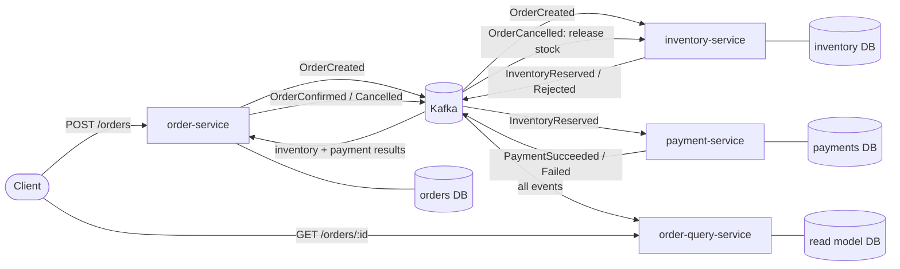

# Event-Driven E-Commerce Backend

A small online-shop backend where microservices talk **only through Kafka events**. It's built to show the patterns that make event-driven systems reliable: the **transactional outbox**, **idempotent consumers**, a **choreographed saga with compensation**, a **CQRS read model**, and **retries with a dead-letter topic**.

**Stack:** TypeScript · NestJS · Kafka (Redpanda) · PostgreSQL · Docker Compose · Jest · GitHub Actions

> 📘 New to these patterns? [`LEARNING.md`](LEARNING.md) explains every step: what was built, why, and exercises to try.

## Architecture



| Service             | Port | Owns                    | Listens to          | Publishes                                    |
| ------------------- | ---- | ----------------------- | ------------------- | -------------------------------------------- |
| order-service       | 3001 | orders                  | inventory, payments | OrderCreated, OrderConfirmed, OrderCancelled |
| inventory-service   | 3002 | products, reservations  | orders              | InventoryReserved, InventoryRejected         |
| payment-service     | 3003 | payments                | inventory           | PaymentSucceeded, PaymentFailed              |
| order-query-service | 3004 | order_view (read model) | everything          | nothing                                      |

## Patterns implemented

| Pattern                             | Where                                                  | Problem it solves                                                                                                     |
| ----------------------------------- | ------------------------------------------------------ | --------------------------------------------------------------------------------------------------------------------- |
| Transactional outbox                | `packages/messaging/src/outbox.*`                      | Saving to the DB and publishing to Kafka can't be atomic (the dual-write problem)                                     |
| Idempotent consumer (inbox)         | `packages/messaging/src/inbox.ts`, `event.consumer.ts` | At-least-once delivery means duplicates. Processing each `eventId` once per service gives effectively-once processing |
| Choreographed saga and compensation | `services/*/src/*consumer.ts`                          | No distributed transactions across services. Failures are undone by releasing stock                                   |
| CQRS read model                     | `services/order-query-service`                         | One fast, join-free view built from three services' events, rebuildable by replay                                     |
| Order-independent projection        | `order-query-service/src/projection.ts`                | Kafka orders messages only within a partition, and the view must not depend on arrival order                          |
| Retry with backoff and DLQ          | `packages/messaging/src/retry.ts`, `event.consumer.ts` | Transient errors are retried. Poison messages are parked in `<topic>.dlq` instead of blocking the partition           |
| Pessimistic locking                 | inventory `FOR UPDATE` (sku order)                     | Two orders can't buy the last item, and there are no deadlocks                                                        |
| Functional core / imperative shell  | `nextState`, `decideReservation`, `charge`, `project`  | Business rules are pure functions that are easy to test                                                               |

## Run it

```bash
docker compose up -d --build       # Kafka, Postgres, Redpanda Console and all 4 services
node tests/e2e/e2e.mjs             # end-to-end checks against the running system
```

Then try it:

```bash
# confirmed
curl -X POST localhost:3001/orders -H 'content-type: application/json' \
  -d '{"customerId":"c-1","items":[{"sku":"BOOK","quantity":1,"unitPriceCents":4500}]}'
# payment declined (over $1,000), so the order is cancelled and stock is released
curl -X POST localhost:3001/orders -H 'content-type: application/json' \
  -d '{"customerId":"c-1","items":[{"sku":"LAPTOP","quantity":1,"unitPriceCents":150000}]}'

curl localhost:3004/orders/<orderId>      # status + event timeline
curl localhost:3004/customers/c-1/orders
curl localhost:3004/stats
curl localhost:3002/products              # watch stock move
```

Watch the events live in Redpanda Console at http://localhost:8080.

**Develop locally** (infra in Docker, services on your machine):

```bash
docker compose up -d redpanda redpanda-console postgres
npm install && npm run build
npm run start:order | start:inventory | start:payment | start:query   # one terminal each
npm test                                                               # unit tests
```

## Project layout

```
packages/contracts     event types shared by all services
packages/messaging     outbox, inbox, consumer base class, retry and DLQ, DB and Kafka wiring
services/*             the four services (each with its own migrations/)
contracts/events       envelope JSON schema and event catalog
tests/e2e              black-box end-to-end test (used in CI)
```

## CI

GitHub Actions runs the build and unit tests, then starts the full stack with Docker Compose and runs the end-to-end test on every pull request.
